# Modelo entidad-relación

Sistema de Gestión de Gastos Administrativos, Supermercado Los Ángeles. Generado a partir de `prisma/schema.prisma`; si el esquema cambia, este diagrama debe actualizarse.

Convenciones: `PK` llave primaria, `FK` llave foránea, `UK` valor único. Montos en colones con dos decimales; fechas de negocio sin hora.

```mermaid
erDiagram
  %% ---------- Usuarios y acceso ----------
  Role ||--o{ User : "se asigna a"
  User ||--o{ Session : "tiene"
  User |o--o{ AuditLog : "realiza"
  User ||--o{ StoredFile : "sube"

  Role {
    uuid id PK
    string name UK
    string_array permissions
    datetime createdAt
    datetime updatedAt
  }
  User {
    uuid id PK
    string fullName
    string username UK
    string email UK
    string passwordHash
    boolean active
    boolean mustChangePassword
    datetime tempPasswordExpiresAt "vence 48 h después"
    datetime passwordChangedAt
    uuid roleId FK
    datetime lastLoginAt
    datetime createdAt
    datetime updatedAt
  }
  Session {
    string id PK "hash SHA-256 del token"
    uuid userId FK
    datetime expiresAt
    datetime createdAt
  }
  AuditLog {
    bigint id PK
    datetime at
    uuid actorId FK
    string action
    string entityType
    string entityId
    json detail
    boolean sensitive "contiene datos salariales"
  }
  StoredFile {
    uuid id PK
    string storageKey UK "llave en S3"
    string fileName
    string mimeType
    int sizeBytes
    uuid uploadedById FK
    datetime uploadedAt
  }

  %% ---------- Empleados y planilla ----------
  Employee ||--|{ EmployeeSalary : "cobra según"
  Employee ||--o{ EmployeeDocument : "tiene"
  EmployeeDocument ||--|| StoredFile : "archivo"
  EmployeeDocument |o--o| EmployeeDocument : "reemplaza"
  Employee ||--o{ Leave : "registra"
  Leave |o--o| StoredFile : "comprobante"
  Employee ||--o{ TimeEntry : "registra"
  Employee ||--o{ SalaryAdvance : "recibe"
  Employee ||--o{ PayrollLine : "aparece en"
  Payroll ||--o{ PayrollLine : "contiene"
  PayrollLine ||--o{ PayrollItem : "desglosa"
  Payroll ||--o{ TimeEntry : "incluye"
  Payroll ||--o{ SalaryAdvance : "descuenta"
  IncomeTaxTable ||--|{ IncomeTaxBracket : "contiene"

  Employee {
    uuid id PK
    enum idType "NATIONAL_ID, DIMEX, PASSPORT"
    string idNumber "UK junto con idType"
    string firstName
    string lastName1
    string lastName2
    date birthDate
    string email
    string phone
    string address
    string position
    date hireDate
    date contractEndsOn
    boolean active
    date statusChangedAt
    string statusReason
    decimal openingVacationDays
    datetime createdAt
    datetime updatedAt
  }
  EmployeeSalary {
    uuid id PK
    uuid employeeId FK
    enum salaryBasis "MONTHLY, HOURLY"
    decimal baseSalary
    date effectiveFrom "UK junto con employeeId"
    datetime createdAt
  }
  EmployeeDocument {
    uuid id PK
    uuid employeeId FK
    enum type "NATIONAL_ID, CONTRACT, CRIMINAL_RECORD, RECOMMENDATION_LETTER, OTHER"
    uuid fileId FK "UK"
    uuid replacesId FK "UK"
    datetime deletedAt
    datetime createdAt
  }
  Leave {
    uuid id PK
    uuid employeeId FK
    enum kind "VACATION, SICK_LEAVE"
    enum sickLeaveType "CCSS, INS, OTHER"
    date startDate
    date endDate
    decimal days
    uuid proofFileId FK "UK"
    datetime voidedAt
    datetime createdAt
    datetime updatedAt
  }
  TimeEntry {
    uuid id PK
    uuid employeeId FK
    uuid payrollId FK
    date date
    enum kind "OVERTIME, UNPAID_LEAVE"
    decimal hours
    string note
    datetime voidedAt
    datetime createdAt
    datetime updatedAt
  }
  SalaryAdvance {
    uuid id PK
    uuid employeeId FK
    uuid payrollId FK
    decimal amount
    date date
    string note
    datetime voidedAt
    datetime createdAt
    datetime updatedAt
  }
  Payroll {
    uuid id PK
    date periodStart
    date periodEnd
    date payDate
    datetime closedAt
    date paidAt
    datetime createdAt
    datetime updatedAt
  }
  PayrollLine {
    uuid id PK
    uuid payrollId FK
    uuid employeeId FK
    enum salaryBasis
    decimal baseSalary
  }
  PayrollItem {
    uuid id PK
    uuid lineId FK
    enum kind "EARNING, DEDUCTION, EMPLOYER_CONTRIBUTION"
    string code
    string description
    decimal quantity
    decimal rate
    decimal amount
  }
  PayrollRate {
    uuid id PK
    enum scope "EMPLOYEE, EMPLOYER"
    enum code "SEM, IVM, BANCO_POPULAR, ASIGNACIONES_FAMILIARES, IMAS, INA, FCL, OPC, INS"
    decimal percent
    date effectiveFrom
    date effectiveTo
    string source
    datetime createdAt
  }
  IncomeTaxTable {
    uuid id PK
    date effectiveFrom UK
    date effectiveTo
    string source
    datetime createdAt
  }
  IncomeTaxBracket {
    uuid id PK
    uuid tableId FK
    decimal lowerBound
    decimal upperBound
    decimal percent
  }
  Holiday {
    uuid id PK
    date date UK
    string name
  }

  %% ---------- Gastos ----------
  ExpenseCategory ||--o{ Expense : "clasifica"
  Expense ||--|{ ExpenseDue : "vence en"
  Expense |o--o| StoredFile : "respaldo"
  ExpenseDue ||--o{ ExpensePayment : "se paga con"
  ExpensePayment |o--o| ExpenseDue : "genera el siguiente"
  ExpensePayment |o--o| StoredFile : "comprobante"
  ExpenseDue ||--o{ NotificationLog : "notifica"

  ExpenseCategory {
    uuid id PK
    string name UK
    string description
    boolean active
    datetime createdAt
    datetime updatedAt
  }
  Expense {
    uuid id PK
    string concept
    uuid categoryId FK
    enum kind "PAYMENT, PERMIT"
    decimal estimatedAmount
    string referenceNumber
    string notes
    enum recurrence "NONE, WEEKLY, BIWEEKLY, MONTHLY, QUARTERLY, YEARLY"
    date recurrenceEndsOn
    int notifyDaysBefore "1 a 10; nulo = sin avisos"
    string_array extraRecipients
    uuid attachmentFileId FK "UK"
    datetime deletedAt
    datetime createdAt
    datetime updatedAt
  }
  ExpenseDue {
    uuid id PK
    uuid expenseId FK
    date dueDate "UK junto con expenseId"
    decimal estimatedAmount
    uuid generatedByPaymentId FK "UK"
    datetime cancelledAt
    datetime createdAt
    datetime updatedAt
  }
  ExpensePayment {
    uuid id PK
    uuid dueId FK
    date paidAt
    decimal amount
    uuid receiptFileId FK "UK"
    datetime voidedAt
    string voidReason
    datetime createdAt
  }
  NotificationRecipient {
    uuid id PK
    string email UK
    datetime createdAt
  }
  NotificationLog {
    bigint id PK
    uuid dueId FK
    date notifyOn "UK junto con dueId"
    string_array recipients
    datetime sentAt
    string error
    datetime createdAt
  }
```

## Reglas del modelo

**Estados calculados, no guardados** (así no pueden contradecir los datos de los que dependen, riesgo R07):
- Empleado activo o inactivo: `Employee.active`, con fecha y motivo del último cambio.
- Vencimiento pagado, vencido o pendiente: pagado si tiene un `ExpensePayment` sin anular; vencido si `dueDate` ya pasó; si no, pendiente. Los vencimientos con `cancelledAt` (generados por un pago que luego se anuló) no cuentan; si se vuelve a pagar, se reactiva el mismo vencimiento.
- Planilla en borrador o cerrada: cerrada si tiene `closedAt`.
- Adelanto pendiente, descontado o anulado: anulado si tiene `voidedAt`; descontado si su planilla está cerrada.
- Salario vigente: la fila de `EmployeeSalary` con la mayor `effectiveFrom` que no sea posterior al inicio del período. Permite programar cambios a futuro (HU-18).
- Saldo de vacaciones: `openingVacationDays` + días acumulados − días tomados.
- Bruto, deducciones y neto de planilla: sumas de `PayrollItem` por tipo.

**Historial sin tablas adicionales:**
- El historial laboral (HU-26) y los cambios de usuarios (HU-5) se leen de `AuditLog`, filtrando por `entityType` y `entityId`. Las filas con `sensitive` solo se muestran con permiso de información salarial. La bitácora se conserva al menos 24 meses (HU-12).
- Lo anulado se marca con `voidedAt` y no se borra: pagos, adelantos, novedades e incapacidades.
- Las versiones de documentos se encadenan con `replacesId`.

**Reglas que la base de datos hace cumplir:**
- No se traslapan los períodos de planilla.
- No se traslapan las vacaciones e incapacidades activas de un empleado.
- No se traslapan los períodos de vigencia de una misma tarifa ni de las tablas de renta.
- Un vencimiento tiene a lo sumo un pago vigente.
- Solo se paga una planilla cerrada.
- Montos, horas y días deben ser positivos.
- Los avisos se configuran de 1 a 10 días, y cada aviso (vencimiento + fecha de aviso) se registra una sola vez, así no se envía dos veces.
- Un empleado inactivo tiene fecha y motivo del cambio.
- Una contraseña temporal siempre exige cambiarla en el primer inicio de sesión.
- Los porcentajes de las tarifas van de 0 a 100 y los tramos de renta de una tabla no se traslapan.
- Los archivos pesan como máximo 10 MB.
- La bitácora (`AuditLog`) no admite cambios ni borrados.

**Tarifas con vigencia** (HU-19, riesgo R12): `PayrollRate` guarda cada componente de las cargas sociales con su período de vigencia y su fuente; `IncomeTaxTable` guarda los tramos de renta por año. Un cambio agrega filas nuevas; de una fila anterior solo se acorta `effectiveTo`, de modo que las planillas pasadas conservan sus tarifas. Las planillas cerradas además guardan una copia del salario usado (`PayrollLine`) y el desglose de montos (`PayrollItem`).

**Fuera del modelo** (se calculan, no se guardan): liquidación, aguinaldo, dashboard y calendario.
